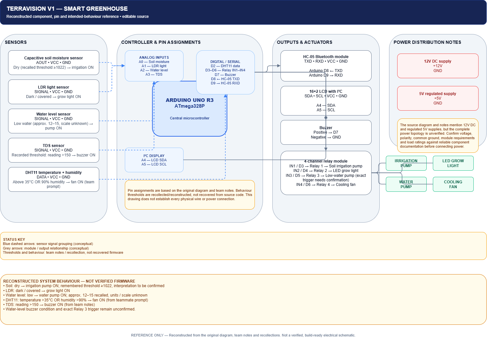

# TERRAVISION V1.0 - Smart Greenhouse Automation System 🌿🤖

An automated microclimate and soil monitoring ecosystem built with Arduino Uno, real-time Bluetooth telemetry (HC-05), and environmental actuators to manage irrigation, ventilation, heating and growth conditions in a compact greenhouse environment.

---

## Quick links

- PROFORMA: [PROFORMA.md](PROFORMA.md)
- Wiring diagram: [Reconstructed TERRAVISION V1 reference](docs/terravision-v1-reconstructed-reference.png)
- Code folder: code/

> Note: This is a learning project — I am still learning C++ and embedded systems. Contributions and feedback are welcome!

---

## Overview

TERRAVISION is a classroom-scale smart greenhouse prototype that monitors soil moisture, temperature & humidity, and light, and performs automated control over irrigation, ventilation, heating and lighting to support resilient plant growth and learning-focused experimentation.

## My Contribution

I contributed to the TERRAVISION V1 project as a hands-on student maker, focusing on turning the concept into a working greenhouse prototype. My work included assembling the hardware, integrating sensors and actuators, and connecting the system for soil monitoring, climate control, and automated irrigation.

This first physical iteration laid the foundation for the later TERRAVISION Digital Twin and V2 development.

---

## Embedded images & diagrams

Reconstructed wiring and component reference:
Reconstructed TERRAVISION V1 wiring and component reference. Based on available project documentation and team recollections; some connections and thresholds remain unverified. Not a build-ready schematic, but useful as a reference for understanding the system.

Add high-resolution PDFs to docs/ if available (docs/circuit-diagram.pdf).

---

## Components (short)

- Arduino Uno
- DHT11 / SHT31 temperature & humidity sensor
- Capacitive soil moisture probe
- LDR (light sensor)
- 4-channel relay module
- 5V/12V mini submersible water pump
- 12V cooling fan
- LED grow strip
- 16x2 LCD with I2C backpack
- HC-05 Bluetooth module

---

---

## Credits

Project converted and documented by Pratyush Pallav Pathak (Ronny) — original team and credits preserved in PROFORMA.md.
